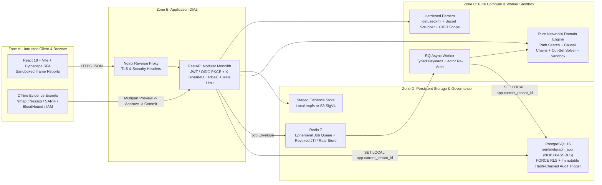

# SentinelGraph — Graph-First Attack-Path Intelligence & Remediation Engine

[](https://github.com/Gautam-Mathur/Sentinelgraph/actions/workflows/ci.yml)


**SentinelGraph** is an authorised, evidence-driven **attack-path intelligence, assumption sensitivity, and minimum-cut remediation platform** for security engineering, defensive assessment, and governance teams.

Rather than rendering a static node-link diagram, SentinelGraph treats its **NetworkX MultiDiGraph engine** as an analytical solver that answers four core defensive questions:

1. **Where can an adversary traverse?** Deterministic risk-weighted (`dijkstra`) and minimum-hop (`bfs`) reachability from external entry points (`is_external_entry`) to critical crown-jewel assets (`is_crown_jewel`).
2. **Why does a path exist causally?** Step-by-step adversary capability chains (`External Exposure -> Service Execution Surface -> Identity & Credential Acquisition -> Privilege Inheritance -> Administrative Control`) grounded in explicit firewall/ACL IDs, ports, protocols, and CVE links.
3. **Which unverified assumptions keep a path alive?** Typed fragility registers and counterfactual **What-If Sensitivity Matrices** (`observed_only`, `>=75%` confidence, missing-ACL closure, CVE patching) with per-step bypass detection.
4. **What is the minimum fix that eliminates the route?** Exact 1-edge chokepoints, 2-edge hitting sets, and greedy multi-edge cut-sets verified 1:1 against an isolated **Sandbox Remediation Simulator** (`segment_network`, `disable_role`, `rotate_service_identity`, `patch_vulnerability`) and post-remediation follow-up scans.

> [!IMPORTANT]
> **Safety & Analytical Boundary**
> SentinelGraph is strictly an **analytical, defensive prioritisation platform**. It models plausible traversal hypotheses from customer-provided, scope-approved **offline** evidence exports.
> It **never** executes exploits, generates payloads, brute-forces credentials, launches live `nmap` scans from HTTP requests, or polls live cloud APIs (`cloud_aws_phase2`, `cloud_azure_phase2`, `cloud_gcp_phase2`, `ms_graph_phase2` return `422 PHASE2_CONNECTOR_DISABLED`).
> Vulnerability observations enforce `exploitability_proven = false` unless corroborated, and `priority_score` (`0..100`) measures structural exposure, privilege leverage, and evidence confidence — **not** statistical breach probability.

---

## Table of Contents

- [Graph Engine Architecture & Intelligence Pipeline](#graph-engine-architecture--intelligence-pipeline)
- [System Topology & Trust Zones](#system-topology--trust-zones)
- [Supported Offline Evidence Formats & Sample Data](#supported-offline-evidence-formats--sample-data)
- [Enterprise Security, Multi-Tenancy & Governance](#enterprise-security-multi-tenancy--governance)
- [Quickstart (Docker Compose & Local Dev)](#quickstart-docker-compose--local-dev)
- [Web Console & Core API Surface](#web-console--core-api-surface)
- [Testing & Quality Verification](#testing--quality-verification)
- [Backup, Restore & Operations](#backup-restore--operations)
- [Repository Layout & Documentation Index](#repository-layout--documentation-index)

---

## Graph Engine Architecture & Intelligence Pipeline

Pure domain logic lives in `backend/app/domain/` with **zero HTTP or SQLAlchemy imports**, enabling deterministic analysis across synchronous endpoints, background RQ workers, and isolated counterfactual simulations.

### 1. Provenance-Typed MultiDiGraph (`graph_engine.py`, `relationship_rules.py`)
- **Controlled Node Kinds (`4`):** `Asset` (`host`, `endpoint`, `server`, `cloud_resource`, `application`, `database`, `network_device`, `identity_provider`), `Service`, `Identity` (`human_user`, `service_account`, `machine_identity`, `workload_identity`, `role_identity`), and `Group`.
- **Domain-Validated Edge Matrix (`10` `RelationType`s):** `EXPOSES`, `CONNECTS_TO`, `RUNS_SERVICE`, `HOSTS`, `DEPENDS_ON`, `HAS_ROLE`, `MEMBER_OF`, `TRUSTS`, `CAN_ADMINISTER`, `OWNS` — each strictly checked against permitted `(source_kind, target_kind)` pairs and rejecting self-loops.
- **Temporal & Epistemic Hygiene (`3` `FactKind`s):** Every edge carries `observed_fact`, `inferred_relationship`, or `analyst_assertion`, a bounded `confidence` in `(0.0, 1.0]`, optional `valid_from`/`valid_to` temporal validity bounds, and `is_suppressed` flags.
- **Structural Diagnostics:** Computes **Tarjan Strongly Connected Components (SCC)** to expose lateral privilege cycles alongside **node and edge betweenness centrality** (`top_bridge_nodes`, `top_bridge_edges`) and stale-observation aging (`>30 days`).

### 2. Deterministic Path Discovery & Scoring (`scoring.py`, `v1.0.0`)
- Supports **risk-weighted shortest path** (`dijkstra`) and **hop-minimum** (`bfs`) searches within configurable safety bounds (`max_hops <= 12`, `max_candidates <= 2000`, execution timeout `<= 5s`).
- Computes a reproducible ranking (`0.00 .. 100.00`) stamped with a canonical SHA-256 `determinism_hash`:

```text
raw_score = 100.0 * impact_weight * exposure_factor * privilege_factor * evidence_confidence * missing_data_penalty
priority_score = round(clamp(0.0, 100.0, raw_score), 2)
```

Inferred relationships incur an explicit `0.85x` confidence attenuation per step so heuristic edges never outrank directly observed evidence. See [Scoring Model v1.0.0](docs/scoring-model.md) for full derivations.

### 3. Causal Chains, Assumptions Register & Sensitivity Matrix (`path_semantics.py`, `graph_intelligence.py`)
- **`capability_chain`**: Translates raw graph edges into ordered tactical mechanisms (e.g., *External Exposure* -> *Network Lateral Movement* -> *Identity & Credential Acquisition* -> *Administrative Control*) enriched with `acl_rule`, `ports`/`protocol`, `requires_cve`, and source provenance.
- **`assumptions_register` & Bypass Counterfactuals**: Surfaces fragile modeling dependencies (missing ACL rule corroboration, inferred heuristic links, `requires_cve` preconditions, stale observations, missing service banners) and computes per-step removal effects (`same_pair_bypasses_remaining`, `is_pair_bridge_chokepoint`, `assessment_paths_broken`).
- **Assessment Sensitivity Matrix**: Re-evaluates the live assessment graph under counterfactual lenses:
  - `observed_only` — Exclude heuristic `inferred_relationship` edges
  - `high_confidence_only` — Require `>= 0.75` evidence confidence
  - `uncorroborated_acls_blocked` — Assume `CONNECTS_TO` / `EXPOSES` edges without an `acl_rule` are firewalled
  - `cve_edges_patched` — Simulate patching CVEs referenced in `requires_cve` transitions

### 4. Minimum Cut-Set Solver & Isolated Sandbox Simulation (`remediation_sim.py`, `graph_intelligence.py`)
- Uses bitmask path-coverage sets to discover:
  1. **1-edge singleton bridge chokepoints** cutting 100% of active routes,
  2. **Minimum 2-edge hitting sets** severing parallel bypass branches, and
  3. **Greedy minimum hitting sets** for larger multi-branch topologies.
- Every candidate cut-set is **verified, augmented against deeper revealed bypasses, and pruned for redundancy** via real `simulate_remediation()` runs on deep-copied sandbox graphs (`is_modelled_only = true`).
- Ranked by `(residual_paths, cut_size, effort_score, -paths_broken)` and rendered directly in the **Cytoscape Graph Explorer** with focus dimming, `[CHOKE]`/`[CUT]` overlays, Blast Radius inspection, and 1-click **Simulate Cut in Sandbox** or inline edge suppression.

---

## System Topology & Trust Zones

SentinelGraph separates untrusted browser/upload parsing, HTTP orchestration, pure domain computation, background jobs, and RLS-enforced storage using a **Modular Monolith + Isolated Worker Queue** pattern:



---

## Supported Offline Evidence Formats & Sample Data

All evidence passes through a strict **two-step staged workflow** (`Upload & Parse Preview -> Approve / Reject -> Idempotent Atomic Commit`) after an assessment's CIDR/host scope is approved (`POST /assessments/{id}/approve-scope`). Ready-to-run synthetic fixtures live in [`sample-data/`](sample-data/).

| `source_format` | Evidence Source | Hardening & Normalisation Controls | Sample Fixture |
| :--- | :--- | :--- | :--- |
| `nmap_xml` | Nmap `-oX` XML scan exports | `defusedxml` blocks DTD/XXE/billion laughs, enforces extension/MIME checks, size cap (`MAX_IMPORT_BYTES`), CIDR scope validation, script allowlist | [`demo_nmap_scan.xml`](sample-data/demo_nmap_scan.xml), [`followup_nmap_scan.xml`](sample-data/followup_nmap_scan.xml) |
| `nessus_xml` | `.nessus` XML vulnerability exports | `defusedxml` hardened parsing, CIDR scope enforcement, host/service/CVE mapping with `exploitability_proven=false` | [`demo_nessus_scan.nessus`](sample-data/demo_nessus_scan.nessus) |
| `sarif_json` | SARIF v2.1.0 & Trivy JSON | Automated finding deduplication, asset extraction, CVSS/severity normalisation | [`demo_trivy_sarif.json`](sample-data/demo_trivy_sarif.json) |
| `bloodhound_json` | SharpHound / BloodHound offline JSON | AD users/computers/groups, `MEMBER_OF` / `CAN_ADMINISTER` / `TRUSTS` mapping, CIDR/host scope checks, secret rejection | [`demo_bloodhound.json`](sample-data/demo_bloodhound.json) |
| `aws_iam_export_json` | Offline AWS IAM & Security Group JSON | Offline IAM principals/roles, ingress security-group `EXPOSES`/`CONNECTS_TO` extraction with `acl_rule` metadata (zero AWS API calls) | [`demo_aws_iam_export.json`](sample-data/demo_aws_iam_export.json) |
| `network_topology_json` / `_csv` | Subnets, VLANs & firewall ACL rules | Extracts subnets, ACL rule identifiers (`acl_rule`), ports, and `CONNECTS_TO` reachability candidates | [`demo_topology.json`](sample-data/demo_topology.json) |
| `identity_json` | User, service account & group exports | Recursive deep secret blocker rejecting `password`, `password_hash`, `ntlm_hash`, `token`, `secret`, `private_key` | [`demo_identities.json`](sample-data/demo_identities.json) |
| `vulnerability_json` | Structured CVE scan exports | CVE deduplication, affected component linkage, non-exploited observation invariant | [`demo_vulnerabilities.json`](sample-data/demo_vulnerabilities.json) |
| `relationship_json` | Explicit host/service/identity edges | Validates every edge against [`relationship_rules.py`](backend/app/domain/relationship_rules.py) (`10` enums, zero self-loops) | [`demo_relationships.json`](sample-data/demo_relationships.json) |

---

## Enterprise Security, Multi-Tenancy & Governance

| Control Area | Implementation Details |
| :--- | :--- |
| **PostgreSQL Row-Level Security** | Non-superuser role `sentinelgraph_app` (`NOBYPASSRLS`) with `FORCE ROW LEVEL SECURITY` across all tenant tables and SQLAlchemy `after_begin` per-transaction `set_config('app.current_tenant_id', ..., is_local => true)`. |
| **Anti-Enumeration & Input Validation** | Cross-tenant UUID lookups return uniform `404 Not Found`. All Pydantic v2 request schemas use `ConfigDict(extra="forbid")` to prevent mass assignment. |
| **Enterprise Identity (OIDC PKCE + Local Guard)** | OIDC Authorization Code + PKCE (`S256`) with JWKS RS/ES verification and state/nonce replay protection (`/api/v1/auth/oidc/login`, `/api/v1/auth/oidc/callback`), rotating refresh tokens, JWT `jti` revocation (`/api/v1/auth/logout`), and Argon2id password hashing. Local seeded login is blocked when `APP_ENV=production` (`LOCAL_AUTH_DISABLED`). |
| **6-Role RBAC Matrix** | Enforced at service boundaries (`backend/app/core/permissions.py`): `tenant_admin`, `assessor`, `analyst`, `remediation_owner`, `auditor`, `read_only` with `LAST_ADMIN_PROTECTED` guard on member suspension/demotion. |
| **Tamper-Evident Audit Chain** | Append-only `audit_events` protected by PostgreSQL trigger `trg_audit_events_immutable` blocking `UPDATE`/`DELETE`, linked via per-tenant SHA-256 hash chains (`prev_hash` -> `event_hash`). |
| **Safe Multi-Format Reports** | Jinja2 auto-escaped HTML rendered in sandboxed `<iframe sandbox="">` previews, formula-injection neutralised CSV, structured JSON, and SARIF v2.1.0 (`GET /api/v1/reports/{id}/download?format=html|json|csv|sarif`), watermarked clearly when generated from synthetic/demo data. |
| **SSRF-Safe Signed Webhooks** | Outbound notifications (`/api/v1/webhooks`) signed with HMAC-SHA256, blocking localhost, private RFC1918 subnets, and link-local metadata endpoints (`169.254.169.254`) unless explicitly overridden in dev. |
| **Retention, Rate Limits & Observability** | GDPR export/deletion across `imports`, `observations`, `reports`, `identities`, and `assessments` (`/api/v1/retention/*`), fixed-window rate limiting (`429 RATE_LIMITED`), secret-redacting JSON logs, Prometheus metrics (`/api/v1/metrics/prometheus`), and OTLP HTTP JSON trace export. |

---

## Quickstart (Docker Compose & Local Dev)

### Option 1: Full Container Stack (Recommended)

```bash
cp .env.example .env
docker compose up --build -d
```

Compose initializes PostgreSQL 16 (`infra/postgres/init.sql`), Redis 7, Alembic migrations (`0001_initial_schema` -> `0002_production_features`), synthetic demo tenants (`acme-demo` and `beta-isolated`), the hardened non-root FastAPI + RQ worker containers (`read_only: true`, `no-new-privileges:true`), and the Nginx/React frontend:

- **Web Console:** `http://localhost:5173`
- **Swagger / OpenAPI Docs:** `http://localhost:8000/api/v1/docs`
- **Health & Readiness:** `http://localhost:8000/api/v1/healthz`, `http://localhost:8000/api/v1/readyz`
- **Prometheus Metrics (authenticated):** `http://localhost:8000/api/v1/metrics/prometheus`

### Option 2: Local Development Mode

```bash
# 1. Start PostgreSQL & Redis
docker compose up -d postgres redis

# 2. Install backend dependencies (Python 3.12+) & apply schema + seed
python3 -m pip install -r backend/requirements-dev.txt
cd backend
python3 -m alembic upgrade head
python3 -m app.seed

# 3. Run API & isolated RQ worker (two terminals from backend/)
uvicorn app.main:app --reload --port 8000
python3 -m app.workers.run_worker

# 4. Run React + Vite UI (frontend/)
cd ../frontend
npm ci
npm run dev
```

Or use the included [`Makefile`](Makefile) shortcuts (`make up`, `make down`, `make migrate`, `make seed`, `make test`, `make lint`, `make typecheck`, `make openapi`).

### Seeded Development Accounts (`APP_ENV != production`)

All seeded accounts share the development password `SentinelDemo!2026` (strictly disabled when `APP_ENV=production`):

| Email | Tenant | Role | Purpose |
| :--- | :--- | :--- | :--- |
| `admin@acme.local` | `acme-demo` | `tenant_admin` | Full tenant, member, retention, webhook & assessment control |
| `assessor@acme.local` | `acme-demo` | `assessor` | Scope approvals, staged import approvals, graph/path & report generation |
| `analyst@acme.local` | `acme-demo` | `analyst` | Evidence uploads, relationship assertions, edge suppression & triage |
| `remediation@acme.local` | `acme-demo` | `remediation_owner` | Sandbox remediation simulations & follow-up scan validation |
| `auditor@acme.local` | `acme-demo` | `auditor` | Read-only posture inspection + immutable audit log export |
| `viewer@acme.local` | `acme-demo` | `read_only` | Read-only operational dashboard & report consumer |
| `admin@beta.local` | `beta-isolated` | `tenant_admin` | Secondary isolated tenant for cross-tenant RLS/IDOR verification |

---

## Web Console & Core API Surface

### Interactive Console Pages (`frontend/src/pages/`)
- **Operations & Intelligence:** `/overview` (KPI summary & top bridge bottlenecks), `/assessments` (interactive Cytoscape Graph Explorer with blast-radius inspector, optimal cut-sets, and sensitivity matrix tabs), `/paths` & `/paths/:pathId` (causal capability chain, typed assumption fragility, per-step bypass analysis, and 1-click sandbox simulation), `/remediations` (what-if simulations & follow-up validation diffing).
- **Inventory & Evidence:** `/imports` (staged preview/approve/commit), `/findings` (CVE triage workflow), `/assets` & `/identities` (banner correction, criticality & lifecycle edits), `/relationships` (manual/inferred edges & challenge/suppression), `/integrations` (data sources & Phase 2 stubs).
- **Governance & Admin:** `/reports` (sandboxed HTML viewer + JSON/CSV/SARIF downloads), `/jobs` (live RQ progress & cancellation), `/audit` (hash-chained event stream & export), `/settings` (members, roles, password rotation, retention & GDPR erasure, webhooks).

### Key API Route Groups (`/api/v1`)

| Prefix | Highlights |
| :--- | :--- |
| `/auth`, `/tenants` | Local login, `/auth/oidc/{login,callback}`, `/auth/refresh`, `/auth/logout`, `/tenants/members`, `/dashboard`, `/search` |
| `/assessments` | Lifecycle creation, `/approve-scope`, `/build-graph`, `/graph`, **`/{id}/intelligence`** (cut-sets, blast radius, sensitivity matrix) |
| `/imports` | Multipart upload & parse preview (`POST /imports`), `/approve`, `/reject`, `/commit` (with `Idempotency-Key` support) |
| `/paths` | `/generate` (`bfs` / `dijkstra`), filtered list, detail view, **`/{id}/intelligence`** (causal chain, `if_falsified` bypasses, subgraph) |
| `/remediations` | Sandbox what-if planning (`POST /remediations/simulate`), follow-up scan validation (`POST /remediations/{id}/validate`) |
| `/assets`, `/identities`, `/findings`, `/relationships` | Asset/service banner corrections, soft retirement, CVE triage status updates, relationship assertions & edge suppression |
| `/reports`, `/jobs`, `/audit`, `/retention`, `/webhooks`, `/integrations` | Multi-format exports, RQ async jobs, immutable audit export, GDPR delete/enforce, HMAC webhook config |

Full OpenAPI 3.1 schema is checked into [`docs/openapi.json`](docs/openapi.json) (`make openapi`).

---

## Testing & Quality Verification

Verification suites mirror [`.github/workflows/ci.yml`](.github/workflows/ci.yml):

```bash
# Ensure PostgreSQL and Redis are running (schema migrated & seeded)
docker compose up -d postgres redis
cd backend && python3 -m alembic upgrade head && python3 -m app.seed && cd ..

# 1. Backend Linting & Compose Validation
ruff check backend tests
docker compose config -q

# 2. Unit, Integration/Security (RLS, IDOR, RBAC, OIDC, Audit), and Performance Suites
pytest tests/unit tests/integration tests/performance -v

# 3. End-to-End Browser Verification (requires Playwright Chromium; spawns isolated test servers)
pytest tests/e2e -v

# 4. Frontend TypeScript Check, ESLint & Production Bundle
cd frontend && npm run typecheck && npm run lint && npm run build
```

See [Test Plan & Verification Matrix](docs/test-plan.md) for marker and coverage scopes (`unit`, `integration`, `security`, `performance`, `e2e`).

---

## Backup, Restore & Operations

- **PostgreSQL Custom-Format Backup** (runs as privileged `postgres` role so `FORCE ROW LEVEL SECURITY` does not omit cross-tenant rows, and writes a `.sha256` manifest):
  ```bash
  ./scripts/backup-db.sh
  ```
- **Verified Restore** (checks SHA-256 checksum, restores cleanly, and asserts `sentinelgraph_app` retains `NOBYPASSRLS`, `>= 10` tables enforce RLS, and `trg_audit_events_immutable` is intact):
  ```bash
  ./scripts/restore-db.sh backups/sentinelgraph_<timestamp>.dump
  ```
- **Production Reverse Proxy & Network Policy References:**
  - TLS termination & HSTS/CSP nginx template: [`infra/nginx/nginx.tls.conf`](infra/nginx/nginx.tls.conf)
  - Kubernetes NetworkPolicy & pod security reference: [`infra/k8s-policy-reference.yaml`](infra/k8s-policy-reference.yaml)

---

## Repository Layout & Documentation Index

```text
sentinelgraph/
├── backend/
│   ├── alembic/             # Schema & RLS migrations (0001_initial_schema, 0002_production_features)
│   └── app/
│       ├── api/v1/          # FastAPI controllers & Pydantic v2 strict schemas
│       ├── core/            # Settings, RBAC permissions, JWT/OIDC, Argon2/MultiFernet, S3/local storage, rate limiting, OTel
│       ├── db/              # SQLAlchemy models & per-transaction RLS context binding
│       ├── domain/          # Pure Python + NetworkX graph engine, causal semantics, scoring v1.0.0, cut-set solver, sandbox sim
│       ├── adapters/        # Hardened offline parsers (Nmap, Nessus, SARIF/Trivy, BloodHound, AWS IAM export, topology, CSV/JSON)
│       ├── services/        # Tenant-safe transaction orchestration & SHA-256 chained audit writer
│       └── workers/         # Shell-free RQ background job dispatcher & worker entrypoint
├── frontend/
│   └── src/                 # React 18 + TypeScript SPA + Cytoscape.js Graph Explorer
├── infra/                   # Postgres init role script, Nginx HTTP/TLS configs, K8s policy reference
├── sample-data/             # Offline synthetic Nmap, Nessus, Trivy SARIF, BloodHound & AWS IAM exports
├── scripts/                 # Postgres backup & verified restore utilities
├── tests/                   # Unit, integration, security/RLS, scale performance & Playwright E2E tests
└── docs/                    # Architecture, threat model, scoring spec, data dictionary & OpenAPI schema
```

### Documentation Index
- [Architecture & Trust Zones](docs/architecture.md)
- [Scoring Model (`v1.0.0`)](docs/scoring-model.md)
- [Data Dictionary & Controlled Enums](docs/data-dictionary.md)
- [Threat Model & Abuse Case Matrix](docs/threat-model.md)
- [Test Plan & Verification Matrix](docs/test-plan.md)
- [Backup, Restore & Disaster Recovery Runbook](docs/backup-recovery.md)
- [Release Notes & Operational Boundaries](docs/release-notes.md)
- [OpenAPI 3.1 Specification](docs/openapi.json)
- [Contributing Guide](CONTRIBUTING.md)
- [Security Policy](SECURITY.md)

---

## License

Released under the [Apache License 2.0](LICENSE).
