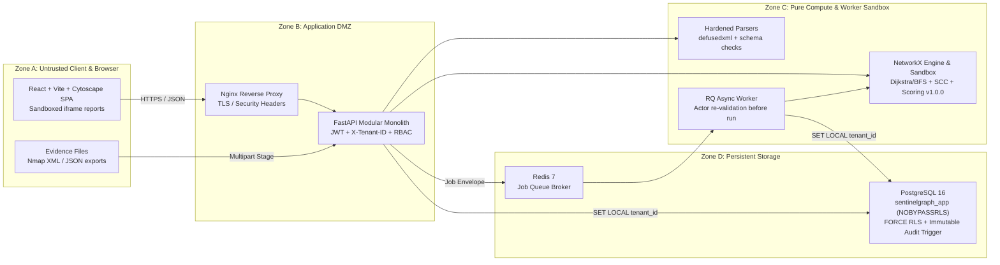

# SentinelGraph Architecture

## Design Paradigm

SentinelGraph uses a **Modular Monolith + Isolated Worker Queue** architecture prioritising strict tenant isolation, deterministic graph analysis, and clean separation of pure domain logic from I/O adapters and HTTP controllers.

```
backend/app/
  ├── api/        FastAPI controllers, JWT/tenant context extraction, request validation
  ├── core/       Config, ErrorEnvelope, Argon2/JWT/MultiFernet security, JSON logging, OTel
  ├── db/         SQLAlchemy models & session management (after_begin RLS context binding)
  ├── domain/     Pure Python + NetworkX graph engine, relationship matrix, scoring v1.0.0,
  │               step semantics, and sandbox remediation simulation (zero HTTP/DB imports)
  ├── adapters/   Untrusted input parsers (defusedxml Nmap XML, topology/identity/vuln JSON)
  ├── services/   Transaction orchestration, staged imports, RBAC enforcement, audit hashing
  └── workers/    Redis/RQ background jobs (shell-free typed Pydantic payloads + re-auth check)
```

---

## System Topology & Trust Zones



---

## Explicitly Enforced MVP Boundaries

| Capability | MVP Status | Enforcement |
| :--- | :--- | :--- |
| Live Nmap execution from API/UI | **Excluded** | No subprocess calls to `nmap`; file upload ingestion only |
| Direct cloud connectors (AWS/Azure/GCP/MS Graph) | **Phase 2 Stub** | Catalog displays `enabled_in_mvp: false`; no outbound polling |
| Graph database (Neo4j / Memgraph) | **Excluded** | Relational persistence in PostgreSQL + on-demand `NetworkX` MultiDiGraph |
| PDF / XLSX exports | **Excluded** | Auto-escaped HTML reports (`text/html`) rendered in sandboxed iframe |
| Autonomous exploit verification | **Prohibited** | Findings explicitly flagged `exploitability_proven: false` |
